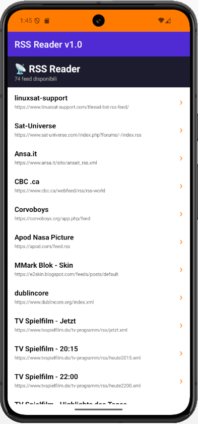
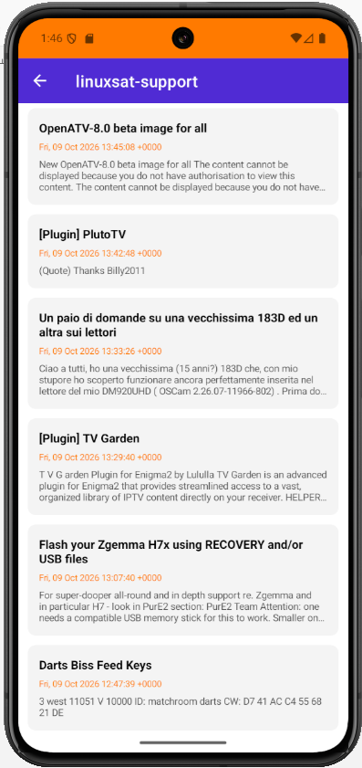
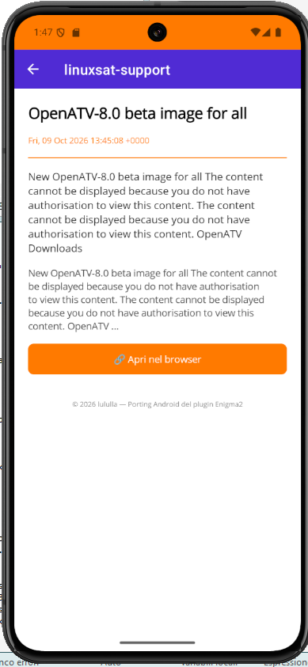
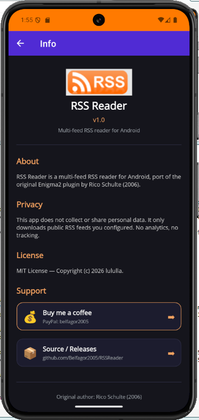

# RSS Reader

**Android RSS Reader — Port of the Enigma2 plugin**

  
  

> Multi-feed RSS reader for Android, port of the original Enigma2 plugin by **Rico Schulte** (2006), maintained by **@lululla**.

---

## 📥 Download

Get the latest APK from [**Releases**](https://github.com/Belfagor2005/RSSReader/releases).

---

## ✨ Features

- 📡 Multi-feed support (configurable `feeds.xml`)
- 🔄 Remote feed list from GitHub (updatable without reinstall)
- 💾 Local fallback when offline
- 📰 RSS 2.0 / RSS 1.0 / Atom parsing
- 🧹 HTML cleanup
- 📖 Article detail view
- 🔗 Open article in browser
- 👆 Pull-to-refresh
- 🌗 Light / Dark theme

---

## 📱 Screenshots

  
  
  
  

---

## 📋 Requirements

- Android 8.0 (API 26) or higher
- ARM64 architecture
- Internet connection

---

## 🚀 Installation

1. Download the latest `.apk` from [**Releases**](https://github.com/Belfagor2005/RSSReader/releases)
2. Enable **"Install from unknown sources"**
3. Open the APK and install
4. Launch **RSS Reader**

---

## ⚙️ Feeds

Feed list is loaded from GitHub (updatable without reinstalling):
